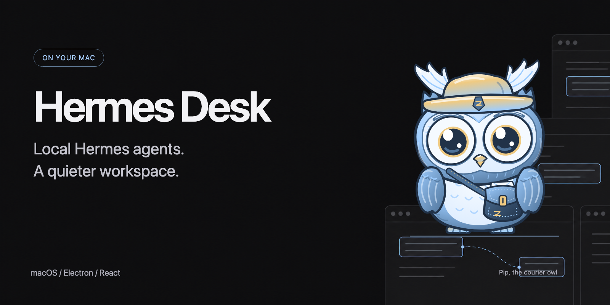
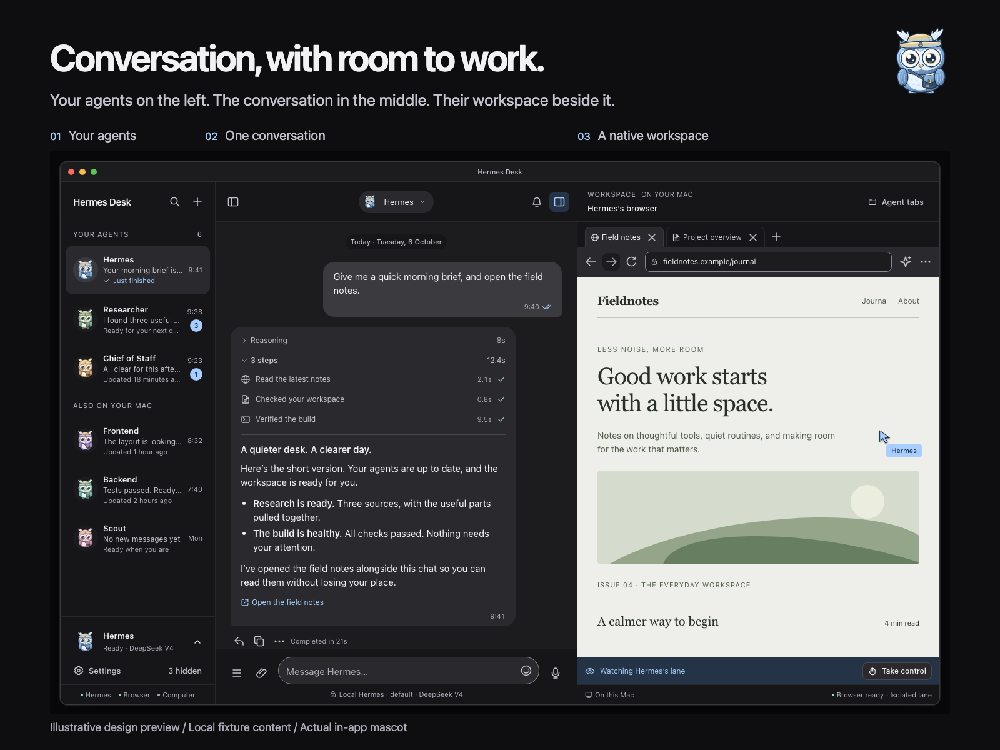
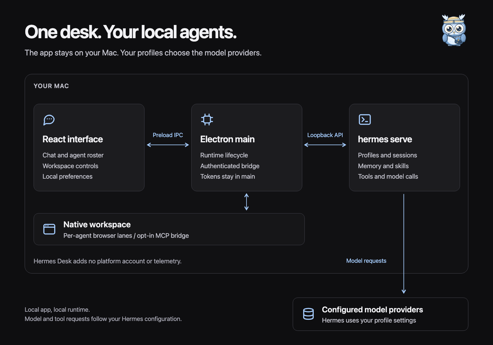
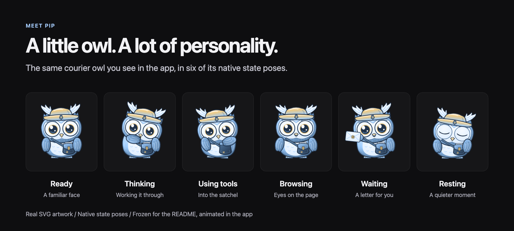
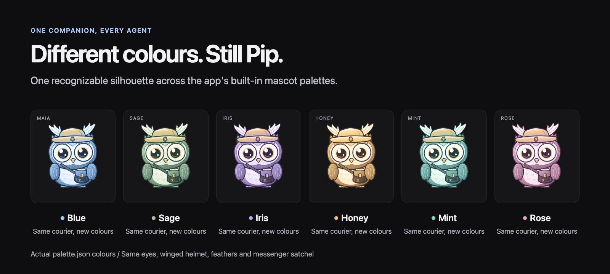

# Hermes Desk



A local-only macOS desktop app for the Hermes agents on your Mac. Built with Electron, React, and Vite. This is a separate project from Nub Agent.

## Workspace preview

Your agents, conversation, and native workspace side by side. This illustrative design preview uses local fixture content, not a live agent session.



## How it works

The React interface connects to local `hermes serve` through Electron's authenticated bridge. Tokens stay in the main process. Hermes uses the model providers configured in your profiles.



## Meet Pip

Pip is the app's courier owl, complete with a winged helmet and messenger satchel. These visuals use the actual SVG rig, native state poses, and built-in palettes, not a generated look-alike.





Artwork sources and regeneration instructions: [tools/readme](tools/readme/README.md).

## Run from source

Requires Node.js 22+, npm, macOS, and a trusted `hermes` CLI on your PATH or in `~/.hermes/hermes-agent/venv/bin`.

```sh
npm ci
npm run dev:local
```

The app starts its own loopback-only `hermes serve` on a free port from 9120 in auto mode, or the configured port in spawn mode, and stops it on quit. It verifies the connected server belongs to that spawned process before sending credentials. The gateway on 8642 is used only for health checks. Tokens stay in the Electron main process.

External serve attachment is blocked: a bearer token authenticates the client, not the server. Choose auto or spawn in local host settings. `HERMES_SERVE_URL` and token environment variables do not authorize attaching to an unverified listener.

### CLI model selection

Desk chats and room members follow their own profile's model/provider configuration, including restored chats. Use `hermes model` for the default profile or `hermes -p <profile> model` for a named agent. Changing one profile does not change the others. A recorded per-chat `/model` choice stays in effect until that profile's model/provider configuration changes.

Legacy saved routes without composer-choice provenance adopt the current profile when reopened; those old snapshots cannot distinguish an automatic restored route from an intentional historical pick.

Open **Chat model and profile** below the composer to see Hermes-reported model/provider metadata, its owning profile, and a copyable CLI command. Before a session reports its route, Desk labels the loaded profile default instead. Offline metadata is marked as last reported; this is not a live availability or pricing check. Recognized model/provider failures expose recovery guidance without automatically retrying.

Click an agent’s chat avatar or name chip to open its profile card. Escape or Close returns keyboard focus; a valid room mention keeps focus in the draft. Former room members and read-only composers do not offer a mention action.

This requires the local Hermes backend extension that accepts `follow_profile_config` on `session.resume`, not just on creation. The installed checkout has that extension; an unmodified older backend will reject the resume rather than silently use the wrong route. Restart Desk after changing backend code. Updating Hermes may replace this local backend patch.

## Build and install

```sh
npm run build
npm run electron:build
npm run install:local
```

`install:local` builds the macOS arm64 app and copies it to `/Applications/Hermes Desk.app`, keeping a backup of any previous installation. Quit the old app before installing. Builds use ad-hoc signing; macOS may ask for approval.

Update by pulling source changes and running `npm run install:local` again. There is no hosted update feed, platform account, or telemetry. Hermes itself uses the model providers configured in your profiles.

## Tests

```sh
npm run test:electron
npm run test:unit
npm run lint
```

`lint` runs required TypeScript and Node syntax checks and returns failure if either fails. `lint:advisory` runs ESLint separately. Electron type checking is incremental: it currently covers bounded reads, navigation guards and agent-environment scrubbing; all tracked Node scripts are syntax-checked without execution.

Isolated macOS tests use fresh profiles and a fake local model, not your real sessions:

```sh
npm run test:e2e
npm run test:rooms
npm run test:genui
npm run test:runtime
npm run test:runtime:dev
```

The E2E harness accepts a trusted Hermes source checkout with an executable `venv/bin/python`, or an installed source with a committed managed environment and provisioned tools in its adjacent Hermes home. Set `HERMES_E2E_SOURCE` to choose the source (the default is `~/.hermes/hermes-agent`). Managed dependencies are copied into the temporary sandbox; the live package store and profiles are not changed. Missing or invalid runtimes fail before startup. No dependency installer runs.

`test:rooms` checks room creation, parallel specialist sessions, a settled Chief wrap, DM/room isolation, reload, concurrent approvals, Stop, changed-origin restart, abrupt backend crashes and token-budget pause/resume. It uses temporary profiles, manual approvals and a loopback-only fake model, not real-provider/model-quality testing.

The profile-model acceptance test changes only a temporary profile's model, verifies adoption and displayed metadata in an open chat and after a full changed-origin restart, verifies another profile stays unchanged, and checks avatar-card keyboard dismissal. Provider-switch and composer-choice contracts run against isolated Hermes configuration and session databases; these checks do not verify live Nous catalog availability.

Use the dropdown beside **New chat → New shared room** to create a room, and **Chats** to reopen it. Room information lets you edit its name, purpose and membership. Leave or clear the name to use member-based naming. Each room retains its own approval queue and each member uses its own local session.

Native room history lives in `local-rooms.json` in Electron's app-data directory, independent of the renderer's development port. The app imports the current origin's old room cache only when no native journal exists. To migrate rooms from an older development port, open that origin first. Native checkpoint failures block new room work rather than silently falling back to a browser cache.

**Reported room usage** shows member-session tokens and a durable per-human-request limit, initially 64,000 tokens. Reaching the limit pauses queued turns; active model calls may finish and exceed it. Raising the limit resumes queued work. Missing usage remains unknown. This is not a billing cap: unreported or auxiliary usage cannot be verified, and no cost estimate is shown without verified prices.

**Bounded Generated UI (`render_ui`)** lets profiles enabled in **Settings → Workspace → Agent browsing** display validated, data-only `stat`, `table`, `bar_chart`, and `checklist` cards in DMs and shared rooms through the local Hermes Desk MCP server (`mcp__hermes_desk__render_ui`), without opening a browser tab or allowing HTML, scripts, links, or remote resources. Checklist checkboxes are local-only notes scoped to the conversation, profile, call, server-issued occurrence, and payload revision; they are never sent back to the agent. See [docs/genui-delivery-2026-10-13.md](docs/genui-delivery-2026-10-13.md) for the contract and [skills/genui/SKILL.md](skills/genui/SKILL.md) for the companion Hermes skill covering `tool_search` discovery and schema bounds.

Rejected sends retain their draft and attachments. An uncertain acknowledgment also retains them but blocks resubmission until you check the transcript, avoiding an automatic duplicate.

See [scripts/README.md](scripts/README.md) for check/probe boundaries and [the gap remediation ledger](docs/hermes-desk-gap-remediation-2026-10-07.md) for remaining work.

For intermittent renderer failures, open **Settings → Advanced → Diagnostics and audit log → Render troubleshooting**. Start capture before reproducing the issue. It is off by default, records only the last 128 metadata events for up to five minutes, and freezes on the first renderer failure. Inspect it there or in the crash fallback. Capture excludes chat text, raw identities and paths; it is never automatically saved, copied or uploaded, clears five minutes after stopping, and does not survive a reload. This is an evidence tool, not a claimed fix for the reported React depth crash.

## Security

Hermes Desk runs entirely on your Mac; agent tokens stay in the Electron main
process and never reach the renderer. To report a vulnerability privately, use
GitHub Security Advisories on this repository or email
`torreykimbrough@gmail.com`. See [SECURITY.md](SECURITY.md) for scope and
response expectations.

## License

MIT — see [LICENSE](LICENSE). That covers the original work here: the app code,
the Pip / Dash / Wisp character rigs and motion engine, and the README renders.

The only third-party material left is the service logos in
`public/brand-marks` and `public/plugin-icons`, which stay the trademarks of
their owners and are used only to identify integrations. See
[THIRD_PARTY_NOTICES.md](THIRD_PARTY_NOTICES.md) for that scope and for the
history note about the avatar engine replaced on 2026-11-02.
