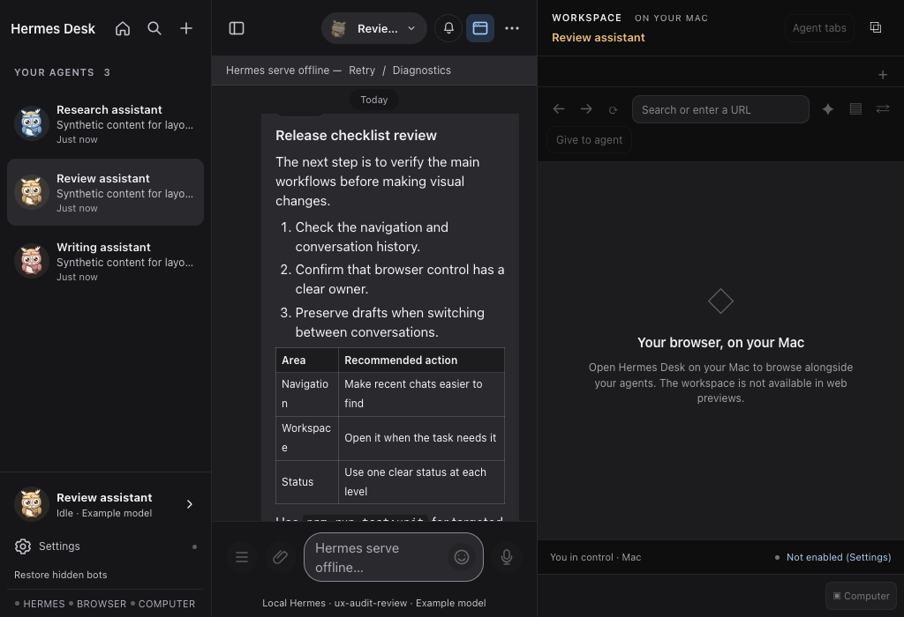

# Hermes Desk: UI/UX audit and professionalization plan

- **Date:** 7 October 2026
- **Status:** Proposed design and implementation plan, not an implemented redesign
- **Scope:** Local macOS desktop experience, with particular attention to Home, chat, navigation, the browser workspace, settings, and permission controls
- **Design direction:** A calm, capable desktop workspace that makes the next action obvious

## Executive recommendation

Hermes Desk does not need a more elaborate visual identity. It needs a more consistent product model.

The charcoal messenger interface, system typography, Pip identity, local-first architecture, and shared controls are good foundations. The strongest improvements will come from making everyday work easier to find, protecting reading and writing space, and making the agent's state and the user's control unmistakable.

The current experience has three competing priorities:

1. Home presents an atmospheric welcome, mascot, and historical activity.
2. The sidebar organizes the product around agents.
3. The main workspace organizes work around conversations and browser lanes.

Each can make sense independently. Their combination currently requires users to infer too much: whether they are starting or resuming work, where older conversations live, why an empty browser is open, and which controls affect the current chat versus the entire app.

**Recommended outcome:** keep the personality, remove unnecessary decisions, and give the application one visual language and one predictable navigation structure.

### Make these changes first

| Order | Change | Why it matters |
| --- | --- | --- |
| 1 | Keep Stop visible while an agent is working, including while the user drafts another message | Control must not disappear when the user starts typing |
| 2 | Protect chat width and open the workspace only when useful | The user's work should not lose space to an empty or unavailable pane |
| 3 | Make New chat, recent chats, and agent selection distinct | Creating an agent is not the same operation as starting a conversation |
| 4 | Put actionable and recent work above historical activity on Home | Resume work before reviewing usage statistics |
| 5 | Use the existing Desk design system across Home and auxiliary surfaces | Consistency will feel more professional than additional decoration |
| 6 | Simplify setup, errors, permissions, and technical language | Users should understand what happened and what to do next |

Do not begin with a framework rewrite, a new component library, another dashboard, or more animation.

---

## Contents

1. [Evidence, scope, and limitations](#1-evidence-scope-and-limitations)
2. [What should be preserved](#2-what-should-be-preserved)
3. [Current findings and priorities](#3-current-findings-and-priorities)
4. [Product model and information architecture](#4-product-model-and-information-architecture)
5. [Layout and responsive behavior](#5-layout-and-responsive-behavior)
6. [Home and launch experience](#6-home-and-launch-experience)
7. [Sidebar, agents, and conversation history](#7-sidebar-agents-and-conversation-history)
8. [Chat, composer, and agent activity](#8-chat-composer-and-agent-activity)
9. [Browser workspace, files, and ownership](#9-browser-workspace-files-and-ownership)
10. [Settings and onboarding](#10-settings-and-onboarding)
11. [Visual system and professional polish](#11-visual-system-and-professional-polish)
12. [Accessibility and keyboard behavior](#12-accessibility-and-keyboard-behavior)
13. [State, feedback, and content standards](#13-state-feedback-and-content-standards)
14. [Implementation architecture and migration](#14-implementation-architecture-and-migration)
15. [Phased delivery plan](#15-phased-delivery-plan)
16. [Validation and success measures](#16-validation-and-success-measures)
17. [Acceptance checklist](#17-acceptance-checklist)
18. [Decisions needed](#18-decisions-needed)

---

## 1. Evidence, scope, and limitations

### 1.1 How this review was conducted

This review combines:

- Inspection of the current React components, styles, state wiring, and local desktop interfaces.
- Rendered inspection of the running Vite preview in a fresh, isolated browser session.
- Screenshots at 1440 × 900, 1024 × 700, and 960 × 640.
- Synthetic agent and conversation content inserted into the isolated browser's in-memory store to examine populated layouts.
- One axe-core accessibility audit of the 1024 × 700 chat fixture.
- A targeted run of existing design-token, primitive, settings-discovery, and chat-control tests.
- Comparison with the repository's previous design specification, UI review, and subsequent remediation notes.

**No application code was changed. No real chats, credentials, local agent profiles, or model requests were used.** Added files are this document and supporting screenshots.

### 1.2 Evidence categories

Recommendations use these distinctions:

- **Observed:** visible in the current rendered preview.
- **Source-confirmed:** established by current implementation, without claiming a native end-to-end reproduction.
- **Historical:** reported by an earlier review; useful context, not automatically a current defect.
- **Proposed:** a design recommendation or target to validate, not an existing behavior or measured result.

This is a heuristic product review, not user research. Claims about confusion or cognitive effort are reasoned risks to test, not measured conversion or satisfaction losses.

### 1.3 Important limitations

- A browser preview does not have Electron's authenticated host bridge or native browser views. Offline status and the unavailable-workspace message are expected in this environment.
- The populated screenshots are **presentation fixtures**, not evidence of live tool execution, real session restoration, approvals, or browser ownership.
- Settings structure was inspected in the rendered preview and source. Native configuration saving, OS dialogs, permissions, and credential flows were not exercised.
- No native VoiceOver session, actual computer control, dictation, or emergency-stop round trip was tested in this pass.
- No startup, frame-rate, memory, or task-completion performance benchmark was run.
- The browser's default color scheme was used. This was not a complete light/classic/dark theme matrix.
- Existing working-tree changes were already present. Line references describe the files reviewed during this pass and may shift as other work continues.

### 1.4 Current screenshots

| Capture | What it establishes |
| --- | --- |
| [Home, empty offline preview](ui-ux-audit-2026-10-07/home-offline-1440.png) | Home's visual identity and priority given to the welcome and activity chart |
| [Shell, empty offline preview](ui-ux-audit-2026-10-07/shell-offline-1440.png) | Multiple setup/offline messages and an open unavailable workspace |
| [Chat fixture, 1440 × 900](ui-ux-audit-2026-10-07/chat-fixture-1440.png) | Current populated chat hierarchy and three-column proportions |
| [Chat fixture, 1024 × 700](ui-ux-audit-2026-10-07/chat-fixture-1024.png) | Narrow chat, wrapped table content, and compressed composer |
| [Home fixture, 1440 × 900](ui-ux-audit-2026-10-07/home-fixture-1440.png) | Recent activity appears below the initial viewport with three agent chips |
| [Chat fixture, 960 × 640, workspace closed](ui-ux-audit-2026-10-07/chat-fixture-960-workspace-closed.png) | The same small window can provide a much more useful reading area without the workspace |

**Current narrow split, synthetic content:**



### 1.5 Relationship to older reviews

Read alongside:

- [Existing Desk design system](plans/hermes-desk-design-system.md)
- [Earlier UI/UX findings](plans/hermes-desk-ux-review.md)
- [Gap remediation ledger](hermes-desk-gap-remediation-2026-10-07.md)
- [Recent improvement follow-up](hermes-desk-improvements-2026-10-07.md)

The older review reported overlapping header controls, poor Markdown contrast, sticky-date occlusion, and other issues. Current code contains explicit repairs for several of those problems. The current screenshots also show readable table/code treatment and separated header controls.

Do not reopen every historical issue as a new ticket. Preserve those regression tests and retest the affected states after structural changes.

---

## 2. What should be preserved

Professional does not mean anonymous, joyless, or feature-poor.

### Keep these strengths

1. **Pip as a recognizable identity.** A small, well-crafted mascot can make agents recognizable without dominating the application.
2. **The charcoal messenger foundation.** Its neutral surfaces and system font already suit a macOS productivity tool.
3. **The existing shared primitives.** `Button`, `IconButton`, `ListRow`, `Toolbar`, `Tooltip`, `Badge`, and related components are preferable to another UI stack.
4. **Readable, tested semantic colors.** The `--desk-*` tokens already distinguish text, surfaces, borders, and status.
5. **Local and cloud boundaries explained honestly.** Chats and browser state can remain on the Mac while configured model providers receive prompts. Do not replace that explanation with “everything stays local.”
6. **Draft and transcript continuity.** Home currently retains the shell underneath it. Simplifying navigation must not discard drafts or reload active conversations.
7. **The command palette and existing shortcuts.** These are valuable accelerators, not substitutes for discoverable controls.
8. **Per-agent browser isolation and explicit handoff.** These are meaningful capabilities and safety boundaries.
9. **Completed-capture labeling.** A computer screenshot is not a live desktop feed.
10. **Existing keyboard and reduced-motion work.** Improve it incrementally instead of rebuilding interaction primitives.

### Evidence of an existing foundation

The targeted verification run passed **110 tests across four files**:

| Test file | Tests passed |
| --- | ---: |
| `src/styles/desk-tokens.test.ts` | 74 |
| `src/components/ui/primitives.test.tsx` | 14 |
| `src/components/__tests__/settings-findability.test.tsx` | 4 |
| `src/components/__tests__/chat-turn-controls.test.tsx` | 18 |

Passing these tests does not certify the entire application. It does show that replacing the current foundations would discard useful work.

---

## 3. Current findings and priorities

### Priority definitions

- **P1:** important control, task clarity, or everyday workflow problem.
- **P2:** repeated friction, consistency, or discoverability problem.
- **P3:** polish or optimization after core behavior is reliable.

Effort estimates below are relative implementation sizes, not delivery commitments. Small means a bounded change; medium spans several components; large changes shell behavior or navigation.

### F01. Home puts historical activity ahead of current work

**Priority:** P1 · **Evidence:** observed and source-confirmed · **Effort:** medium

The rendered Home fixture placed:

- The welcome hero at `y=89`, height `464px`.
- The activity heatmap at `y=590`, height `295px`.
- The Recent activity section at `y=922`.
- The first recent row at `y=1003`.

The viewport was only `900px` high. These measurements include the offline banner and three fixture agents. They are one state, not a universal measurement, but the hierarchy is explicit in the source: the heatmap precedes recent work.

**Why it matters:** the landing experience emphasizes atmosphere and past usage before helping someone resume a task or answer an agent.

**Recommendation:** show Needs your attention and Recent chats first. Move the heatmap below them in a collapsed Activity history section.

**Source:** [HomePage.tsx:105-173](../src/components/home/HomePage.tsx#L105), [home.css:106-165](../src/components/home/home.css#L106).

**Acceptance:** at 1280 × 800 with five representative recent chats, the first actionable row and at least three recent rows are visible without scrolling.

### F02. Starting, resuming, and viewing conversations have misleading labels

**Priority:** P1 · **Evidence:** observed and source-confirmed · **Effort:** small to medium

“Start a session” calls `onOpenAgent`. `openAgent` selects the latest existing conversation when one exists. In the fixture, this button opened an existing conversation rather than creating a new one.

“All conversations” calls `onOpenApp`, which simply leaves Home and returns to the retained shell. It does not open an all-conversations list. The sidebar then shows agents, not an explicit conversation archive.

**Why it matters:** a user cannot reliably predict whether an action creates a new context, resumes old context, or opens a list.

**Recommendation:**

- **Continue chat** resumes a named conversation.
- **New chat** always creates a fresh conversation for a known agent.
- **All chats** opens an actual searchable list.
- **Open workspace** returns to the main shell when that is the intended operation.

Do not merely rename “Start a session” to “New chat” while keeping its current behavior.

**Source:** [HomePage.tsx:117-126](../src/components/home/HomePage.tsx#L117), [App.tsx:159-170](../src/App.tsx#L159), [App.tsx:177-184](../src/App.tsx#L177).

### F03. An open workspace consumes too much of a small window

**Priority:** P1 · **Evidence:** observed and source-confirmed · **Effort:** medium

At 1024 × 700, the inspected split measured:

| Region | Width |
| --- | ---: |
| Sidebar | 240px |
| Chat | 368px |
| Workspace | 416px |
| Composer wrapper inside chat | 336px |
| Textarea inside composer | 144px |

The header no longer visibly overlaps in this capture. That historical defect should not be confused with the remaining issue: the layout is technically contained but uncomfortable for actual work.

An ordinary Markdown table wraps short words across lines. The offline placeholder wraps inside the textarea. The unavailable workspace is wider than the chat.

**Recommendation:** use a content-width budget and switch to a single active work area before the chat becomes this narrow. Default the workspace closed for new users until needed.

**Source:** [App.tsx:60-65](../src/App.tsx#L60), [App.tsx:629-635](../src/App.tsx#L629), [workspace.css:25-30](../src/styles/workspace.css#L25), [SidePanel.tsx:113-126](../src/components/SidePanel.tsx#L113).

### F04. The visible Stop action depends on the draft being empty

**Priority:** P1 · **Evidence:** source-confirmed · **Effort:** medium

`ChatPanel` supplies the messenger Stop handler only when the draft is empty and there are no attachments. `MessengerComposer` then uses one position for Send, Stop, or dictation.

The existing emergency shortcut, Command-period, remains available even inside the composer. The issue is not that stopping is impossible. It is that the visible control disappears during a common multitasking action: drafting a follow-up.

**Recommendation:** separate agent control from message submission. Keep a stable **Stop** action in the current-run status row while a run is active, independent of draft contents.

**Source:** [ChatPanel.tsx:3990](../src/components/ChatPanel.tsx#L3990), [MessengerComposer.tsx:123-160](../src/components/chat/MessengerComposer.tsx#L123), [shortcuts.ts:17-21](../src/lib/shortcuts.ts#L17).

**Acceptance:** users can stop an active turn with an empty draft, multiline draft, or attached file. Stopping preserves the unsent draft. The control stays in a pending state until the backend confirms the interruption.

### F05. Navigation favors agent administration over everyday chat work

**Priority:** P1 · **Evidence:** source-confirmed, supported by rendered inspection · **Effort:** large

The sidebar header exposes Home, Search, and New agent. Its main list exposes agents. It does not expose a comparably clear New chat action or a task-titled recent-chat list.

A user who wants another conversation may mistake the plus icon for New chat. The accessible label is accurate, but the visible distinction is weak.

**Recommendation:** make **New chat** the primary sidebar action. Keep agents as stable targets and filters. Move **New agent** into the Agents section's menu.

**Source:** [Sidebar.tsx:464-476](../src/components/Sidebar.tsx#L464), [Sidebar.tsx:481-550](../src/components/Sidebar.tsx#L481).

### F06. Home and the working interface look like different products

**Priority:** P2 · **Evidence:** observed and source-confirmed · **Effort:** medium

Home overrides the Desk palette with teal, cream, gold, a panoramic background, glow, blur, and gradient buttons. Chat uses charcoal surfaces, neutral controls, and a pale blue accent.

The problem is not that the Home artwork is poor. It is that crossing a navigation boundary changes the visual rules.

**Recommendation:** use Desk surfaces and controls on Home. Retain the coastal artwork as an optional welcome background, not the mandatory frame for daily work.

**Source:** [home.css:3-39](../src/components/home/home.css#L3), [home.css:174-207](../src/components/home/home.css#L174), [desk-tokens.css:6-30](../src/styles/desk-tokens.css#L6).

### F07. Setup and disconnection produce too many competing messages

**Priority:** P2 · **Evidence:** observed in the no-bridge preview, source-confirmed composition · **Effort:** medium

The empty offline shell simultaneously displayed:

- A sidebar connection error and Retry.
- A no-agents empty state with Open Settings.
- A main offline banner with Retry and Diagnostics.
- A setup block with Check Hermes setup and Got it.
- An offline chat empty state.
- An unavailable workspace.

The missing bridge is expected in this preview. The design issue is the composition of those states, not evidence that native Hermes fails to connect.

**Recommendation:** choose one dominant recovery state. Show one primary repair action and one secondary diagnostics route. Do not leave an unusable optional workspace occupying half the window.

**Source:** [App.tsx:580-588](../src/App.tsx#L580), [Sidebar.tsx:477-480](../src/components/Sidebar.tsx#L477), [Sidebar.tsx:553-557](../src/components/Sidebar.tsx#L553), [WorkspacePane.tsx:223-228](../src/components/workspace/WorkspacePane.tsx#L223).

### F08. Permission choices are concise but underspecified

**Priority:** P1 · **Evidence:** source-confirmed · **Effort:** medium

The inline permission choices are “Once,” “Session,” “Always,” and “Deny.” These labels do not independently explain what permission lasts for, what it applies to, or how it is revoked.

The existing high-stakes filter correctly restricts those requests to once or deny. Preserve that boundary.

**Recommendation:** use explicit action labels and show scope before approval. Map descriptions to the backend's actual permission semantics; do not invent a narrower scope in the UI than the server enforces.

**Source:** [InlineApproval.tsx:4-32](../src/components/chat/InlineApproval.tsx#L4).

### F09. Control density and vocabulary still reflect implementation details

**Priority:** P2 · **Evidence:** observed and source-confirmed · **Effort:** small to medium

Examples include:

- “Restore hidden bots” beside “Your agents.”
- “Start a session” alongside chats and conversations.
- “Hermes serve,” “scratch profiles,” “lanes,” and “main.”
- An attachment label describing the “agent computer” even in the local Mac experience.
- A model command that opens general setup rather than an inline model picker.

Technical terms are appropriate in diagnostics. They should not be prerequisites for everyday navigation.

**Recommendation:** one user-facing vocabulary, with exact technical identifiers in secondary detail. State when a model value is read-only rather than making it look like a quick picker.

**Source:** [MessengerComposer.tsx:107-118](../src/components/chat/MessengerComposer.tsx#L107), [App.tsx:599-600](../src/App.tsx#L599), [settings-index.ts:12-49](../src/lib/settings-index.ts#L12).

### F10. Settings are searchable but lead with infrastructure

**Priority:** P2 · **Evidence:** source-confirmed and rendered navigation inspection · **Effort:** medium

The first settings section is Hermes. It introduces the local home directory, serve mode, port, and gateway before ordinary appearance or notification preferences.

Search and keyboard navigation already exist. The improvement is ordering and progressive disclosure, not inventing search.

**Recommendation:** start with a plain connection summary and common preferences. Put port, attach/spawn policy, gateway, and logs in advanced setup or diagnostics. Preserve existing deep links through aliases.

**Source:** [SettingsStub.tsx:133-184](../src/components/SettingsStub.tsx#L133), [settings-index.ts:12-51](../src/lib/settings-index.ts#L12).

### F11. Accessibility still needs a rendered-semantics pass

**Priority:** P2 · **Evidence:** automated result plus source inspection · **Effort:** small to medium

The scoped axe-core 4.12.1 run reported **two rule violations**:

1. `aria-prohibited-attr`: `.workspace-viewport` is a generic `div` with an `aria-label` but no naming-compatible role.
2. `page-has-heading-one`: the chat page has no level-one heading. Axe tags this as a **best-practice** issue, not a standalone WCAG failure.

It also reported **three incomplete rule groups** requiring review:

- Labels on several generic elements, including connector states and sent ticks.
- An empty workspace `tablist` without tabs in the unavailable state.
- Contrast review for a decorative non-text workspace symbol.

Separately, the right-panel resize separator has pointer handling but no keyboard focus or keyboard resize handling in its current component. The sidebar resize separator already supports keyboard operation.

**Recommendation:** improve actual roles, status text, and focus behavior, not just add more ARIA attributes.

**Source:** [SidePanel.tsx:121-126](../src/components/SidePanel.tsx#L121), [Sidebar.tsx:596-627](../src/components/Sidebar.tsx#L596).

### F12. Visual-system fragmentation makes future consistency harder

**Priority:** P2 · **Evidence:** source-confirmed · **Effort:** medium, incremental

The application includes:

- Legacy `--ca-*` tokens.
- Newer `--desk-*` tokens.
- Workspace-specific `--ws-*` colors.
- Home-specific overrides.
- Component-local styling and compatibility rules.

This does not mean every screen is broken. It means an apparently simple adjustment can take different paths through different surfaces.

**Recommendation:** choose `--desk-*` as the canonical semantic layer for the desktop experience and migrate touched surfaces gradually.

**Source:** [desk-tokens.css](../src/styles/desk-tokens.css), [workspace.css:1-23](../src/styles/workspace.css#L1), [home.css:3-32](../src/components/home/home.css#L3), [index.css](../src/index.css).

---

## 4. Product model and information architecture

### 4.1 Use three concepts consistently

| Concept | User-facing meaning | What it is not |
| --- | --- | --- |
| **Agent** | A configured assistant with its own identity, capabilities, and preferences | A single chat |
| **Chat** | One continuing piece of work with an agent | A new agent or a browser session |
| **Workspace** | Supporting browser and file context for the selected work | A mandatory permanent column |

Use **routine** for scheduled work. Keep profile, session ID, transport, MCP, and lane as technical detail where needed.

This is a language layer, not a request to rename backend entities or persistent keys.

### 4.2 Recommended navigation structure

```text
Hermes Desk
  New chat
  Search

  Home
  Chats
  Routines

  Agents
    Review assistant
    Research assistant
    Writing assistant
    Manage agents

  Settings
  Connection status
```

Rules:

- Three primary destinations are enough: Home, Chats, and Routines.
- Agents remain directly selectable. Selecting one filters or opens its recent work.
- Chats is the actual conversation archive, with titles, agent names, and last activity.
- Search is global. Search results identify whether they refer to a chat, message, agent, file, setting, or action.
- Files stay contextual to the selected chat/workspace. Do not add a global file-management product in the first redesign.
- Agent details belong in an inspector. They are not the main route to everyday chat actions.
- Routine access should not require knowing to open agent details or a command.

### 4.3 Do not duplicate full lists

Avoid stacking a complete agent list and a complete conversation list in the same narrow sidebar.

Use:

- A bounded agent roster in the navigation.
- A main Chats view for the full archive.
- A recent-chat selector in the chat header for the selected agent.

For small rosters, the agent list can remain expanded. For large rosters, add filtering and a bounded scroll region before introducing folders or organization features.

### 4.4 Preserve compatibility

- Keep existing `#/c/...` deep links working.
- Preserve links to agent details, files, settings sections, and routines.
- New visible labels should not silently rename persistence keys or server identifiers.
- Existing launch preferences remain respected during migration.
- Browser Back should restore the previous destination and selected conversation without losing drafts.

---

## 5. Layout and responsive behavior

### 5.1 Replace “everything fits” with “the main task remains usable”

A layout can have no overflow and still be unusable.

The current 144px textarea at a 1024px window demonstrates why viewport containment is not enough. Minimum usable content space needs to be a first-class layout constraint.

### 5.2 Proposed width budget

These are starting design targets to validate with the current system font:

| Region | Preferred | Minimum in split view |
| --- | ---: | ---: |
| Expanded navigation | 224-240px | 208px |
| Compact navigation | 60px | 60px |
| Chat column | 560-760px | 480px |
| Browser workspace | 400-520px | 360px |
| Right-side details inspector | 360-420px | 320px |
| Composer editable area | Flexible | 280px |

Use the **actual current sidebar width**, not a constant assumption.

```text
available chat width =
  window content width
  - current navigation width
  - workspace width
  - pane separators

If available chat width < 480px:
  do not retain a three-column split
  show Chat or Workspace as the main work area
```

The threshold must react to manual sidebar resizing, text scaling, and inspector state, not only a global media query.

### 5.3 Example layout targets

Approximate allocations below include 1px separators:

| Window width | Navigation | Chat | Workspace behavior |
| --- | ---: | ---: | --- |
| 1440px | 240px | 718px | 480px dock, only when opened |
| 1280px | 224px | 654px | 400px dock, only when opened |
| 1024px | 224px | 799px | Workspace replaces the main area when explicitly selected |
| 960px | 208px | 751px | Same single-work-area behavior |

A user may voluntarily use compact navigation to regain split view if the minimum widths fit. Do not silently collapse their navigation on every window resize.

### 5.4 Recommended shell

```text
+----------------------+---------------------------------+-------------------------+
| Hermes Desk          | Chat title                      | Workspace               |
| [New chat] [Search]  | Agent · status         [More]   | Browser | Files         |
|                      +---------------------------------+-------------------------+
| Home                 |                                 |                         |
| Chats                | Answer / tool summary           | Page or file preview    |
| Routines             |                                 |                         |
|                      |                                 |                         |
| Agents               |                                 |                         |
|   Review assistant   |                                 |                         |
|   Research assistant |                                 |                         |
|                      +---------------------------------+-------------------------+
| Settings             | Working: reading page [Stop]    | Control owner [Action]  |
| Hermes connected     | [Attach] Message... [Send]      |                         |
+----------------------+---------------------------------+-------------------------+
```

At constrained width:

```text
+----------------------+-----------------------------------------------------------+
| Navigation           | Chat title                         [Chat] [Workspace]    |
|                      +-----------------------------------------------------------+
|                      | One usable work area, not two compressed work areas      |
|                      |                                                           |
|                      +-----------------------------------------------------------+
|                      | Stable run control and composer when Chat is selected    |
+----------------------+-----------------------------------------------------------+
```

### 5.5 Panel behavior

- Keep at most one contextual inspector beside chat.
- Opening agent information should not produce a fourth narrow column.
- Opening Files should preserve the selected browser tab, but need not keep its native view visible.
- Closing a panel restores the previous usable layout, not an invalid persisted width.
- Persist the user's preferred width separately from the clamped width used in the current window.
- On resize, preserve transcript scroll position and focused controls.
- A pane switch is navigation, not a destructive operation.

### 5.6 Native desktop considerations

Electron native browser views are not ordinary DOM elements. A high CSS `z-index` cannot reliably put a dialog over them.

Retain the current native-view visibility/bounds coordination when opening:

- Settings.
- Command palette.
- Permission and handoff dialogs.
- File previews.
- Reader view.
- Agent creation or details.

Test these behaviors in the isolated Electron harness, not only the browser preview.

---

## 6. Home and launch experience

### 6.1 Define Home's job

Home should answer:

1. Does anything need my attention?
2. What was I working on?
3. How do I start something new?

It should not primarily answer how many days the app was used.

### 6.2 Proposed Home order

1. **Compact heading:** “Home” or a short greeting, with a small Pip.
2. **Needs your attention:** only when an approval, question, failure, or paused task exists.
3. **Continue working:** three to five recent chats.
4. **New chat:** one clear action with a visible agent choice.
5. **Recent results:** only if actual completed work has useful artifacts.
6. **Activity history:** collapsed by default.

Do not create empty cards for sections without meaningful content.

### 6.3 Visual changes

- Reduce the 208px mascot stage to a compact identity treatment.
- Start with a 40-64px mascot on daily Home.
- Use the existing Desk neutral surfaces.
- Remove the permanent glow and gradient primary button from the default work view.
- Keep the coastal background available as an explicit appearance preference or first-run welcome treatment.
- Use left alignment for working lists and actions.
- Keep the page content width bounded, but do not surround a small action list with a large decorative hero.

### 6.4 Activity history

The heatmap can remain useful for people who enjoy it. Its accessible table fallback is worth preserving.

However:

- Do not put it above blocked or recent work.
- Do not equate streak length with work quality.
- Avoid three empty statistic tiles for a brand-new user.
- Explain the counted event if the chart remains: chats, active days, or another defined measure.
- Keep unavailable and zero values distinct.

### 6.5 Launch defaults

Recommended policy:

- **First launch:** focused setup and a route to the first chat.
- **Returning user:** reopen the last useful destination.
- **User-selected Home preference:** honor it.
- **Deep link:** open the requested destination.
- **Disconnected state:** preserve the requested context and draft; present recovery in place.

Do not force an existing user away from Home during an upgrade. Offer the new launch default without overwriting their explicit preference.

---

## 7. Sidebar, agents, and conversation history

### 7.1 Separate creating work from creating an assistant

The most prominent action should be **New chat**.

Its behavior:

1. Use the selected agent if one exists.
2. Otherwise show a short agent picker.
3. Create an empty chat without altering the agent configuration.
4. Focus the composer.

Creating an agent becomes a secondary action in the Agents section and management screen.

### 7.2 Make rows useful, not decorative

Each agent row needs:

- Stable avatar.
- Name.
- One concise secondary line.
- A meaningful unread or attention indicator when needed.

Choose one secondary-line priority:

1. Waiting for approval or an answer.
2. Current running activity.
3. Latest useful chat preview.
4. Last active time.

Avoid always showing all four at equal weight.

### 7.3 Reduce repeated identity

The selected agent is currently represented in the roster, footer card, chat header, workspace header, and transcript.

Some repetition is necessary for ownership. Not all of it needs an avatar and separate card.

Recommended treatment:

- Keep the roster avatar.
- Keep the agent name in the chat header.
- Keep ownership text in the workspace.
- Make the bottom agent card optional or replace it with a compact details action.
- Use one small avatar at the start of an assistant turn, not on every fragment.

### 7.4 Keep the roster stable

While the pointer or keyboard is navigating the roster:

- Do not reorder rows because a timestamp changed.
- Show activity in place.
- Preserve explicit pinned order.
- Defer nonessential sort changes until navigation is finished.

This is a proposed interaction rule, not a claim that current sorting always moves rows during interaction.

### 7.5 Chats archive specification

Build on existing conversation data and search facilities.

Each row should show:

- Chat title based on the work, not only the agent's name.
- Agent name.
- Last useful preview.
- Last updated time.
- Attention or running state if relevant.

Provide:

- Search.
- Agent filter.
- Recent/pinned grouping if already supported.
- An explicit empty state.
- Pagination or incremental loading.

Preserve the distinction between hide, archive, and delete. Do not introduce destructive semantics through a visual cleanup.

---

## 8. Chat, composer, and agent activity

### 8.1 Header hierarchy

The main heading should identify the current piece of work.

Recommended hierarchy:

```text
Review release checklist
Review assistant · Ready
```

If the chat has no title, use “New chat” with the agent below it.

Primary header actions:

- Recent chats / chat selector.
- Workspace.
- More.

Agent information remains available through the agent name or a labeled menu item. Do not make a small centered identity pill carry title, agent selection, information, and state responsibilities at once.

### 8.2 Composer: stable layout, fewer decisions

Recommended default:

```text
Attachment chips, when present

[Attach]  Message Review assistant...                  [Send]

Example model · On this Mac                    Enter to send
```

Optional voice input can remain available when configured. Emoji and slash-command browsing can move into the attachment/More menu. Typed slash commands remain supported.

Rules:

- Send stays in a stable position.
- The textarea grows to a bounded height before it scrolls.
- Attachments have filenames, upload states, and removal controls.
- Disabled Send has a visible explanation when the reason is not obvious.
- Enter behavior respects IME composition and multiline input.
- Drafts survive route changes, offline transitions, and workspace switches.
- Model details are descriptive unless the action genuinely supports model selection.
- Do not display a fully qualified provider/model identifier as unavoidable chrome if a shorter label is available.

### 8.3 Keep Stop independent

While a turn is active:

```text
Review assistant is reading a page...                [Stop]
```

This row belongs immediately above the composer or in a consistent current-run area.

State rules:

| State | Stop treatment |
| --- | --- |
| Running | Visible and available |
| Draft has text | Still visible |
| Draft has attachments | Still visible |
| Stop requested | “Stopping…” with duplicate requests prevented |
| Backend confirms interruption | “Stopped” summary; retain partial answer and draft |
| Stop request fails | Inline failure with a retry path; do not pretend it stopped |

Keep Command-period as emergency Stop all. Distinguish current-turn Stop from Stop all agents when both exist. Do not silently change the scope of an existing backend operation.

### 8.4 Present answers before machinery

Use one coherent assistant turn:

1. Compact current activity or completed activity summary.
2. The answer.
3. Important artifacts or results.
4. Detailed tool activity behind disclosure.

For completed work:

```text
Completed 4 steps                                  [Details]

Here is the release checklist...
```

Numbers above are illustrative interface copy, not measured task results.

Do not render every internal tool event as an equally prominent card. Expand automatically only when the information is needed for approval, recovery, or understanding a failure.

### 8.5 Long-form reading

- Keep body text at least the existing 15px/22px baseline.
- Target approximately 65-85 characters per line for prose.
- Let structured answers use the available chat width.
- Allow code and wide tables to scroll horizontally within their own container.
- Do not compress table labels into single-character columns.
- Keep message actions outside text and tool content.
- Keep dates out of the reading path.
- Do not autoscroll users away from content they are reading.
- When new content arrives below a scrolled position, show a clear “Jump to latest” action.

Preserve existing bottom-follow, hover-bridge, and transcript-loading regressions when changing message geometry.

### 8.6 Approval cards

A permission card should answer:

- Which agent is asking?
- What action will it take?
- What resource or website is affected?
- What permission scope is being requested?
- What happens if I decline?

Suggested copy:

```text
Review assistant wants to run a command

Purpose: inspect the project files
Scope: this command only

[Show command]

[Don't allow]  [Allow once]
```

For broader permissions, use explicit labels such as **Allow for this session**, but only if “session” is defined and matches actual enforcement.

Keep persistent grants in a secondary disclosure with a clear explanation and revocation route. High-stakes actions retain per-action approval and must not gain an “Always” path.

Do not preselect the permissive option or apply a keyboard default that can accidentally approve when focus moves.

---

## 9. Browser workspace, files, and ownership

### 9.1 Open the workspace intentionally

For new preferences, the workspace starts closed unless restored state makes it useful.

Open it when:

- The user requests it.
- The user opens a relevant page or file.
- A task requires a visible browser context and the user has enabled that capability.

Do not open it merely because the component exists.

Avoid stealing keyboard focus when agent activity updates the workspace. Background work can advertise an available result without switching the user's view.

### 9.2 Use one contextual area

A proposed Workspace switcher can provide:

- **Browser**
- **Files**

This consolidates related viewing surfaces without implying that files inherit browser permissions.

Preserve:

- Browser tab and scroll state.
- File-list location and selected file.
- Unsaved-preview guards.
- The selected chat's working directory and scope.

The initial delivery may retain the current separate Files panel. Consolidation should follow navigation and layout fixes, not block them.

### 9.3 Browser chrome

Always available when applicable:

- Back.
- Forward.
- Reload.
- Address.
- Current ownership.
- Take control or Resume.

Secondary actions:

- Reader preview.
- Ask about this page.
- Move to another agent.
- Copy sign-in.
- Less common tab operations.

Place secondary actions in a labeled menu at constrained widths. Do not let them push the address field or ownership action into an unpredictable second toolbar row.

### 9.4 Ownership must be unmistakable

| Condition | Plain status | Primary action |
| --- | --- | --- |
| User owns the tab | You control this tab | Give to agent |
| Agent is actively using it | Review assistant is controlling this tab | Take control |
| Agent paused by takeover | Agent paused; you have control | Resume agent |
| Browsing not enabled | Agent browsing is off | Set up browsing |
| Connector unavailable | Browser connection unavailable | Retry |

Ownership is safety information. Keep it textual and persistent. Color can reinforce it but cannot carry it alone.

Handoff must explain:

- The receiving agent.
- Which tab is being transferred.
- Whether the agent receives signed-in access.
- Any instruction to send.
- How to take control back.

### 9.5 Computer preview

Retain the honest completed-capture model.

Prefer:

```text
Computer capture
Captured 18 seconds ago
```

The time above is example copy. Use a real capture timestamp.

Do not call this “Live” unless the implementation actually supplies a live feed. Keep capture permission, computer input control, and browser control as distinct capabilities.

### 9.6 Empty workspace

If the native workspace is available but empty:

```text
No page open
Open a page yourself or let this agent browse after setup.
[Open page]
```

If it is unavailable in a browser preview:

```text
Browser workspace is available in the Mac app.
```

An unavailable pane should not look like a large collection of almost-invisible controls.

---

## 10. Settings and onboarding

### 10.1 Simplify organization, not capability

Recommended settings hierarchy:

| Section | Contents |
| --- | --- |
| General | Launch destination, notifications, sounds, connection summary |
| Agents | Agent identity, visibility, model information, approval policy, time zone |
| Workspace | Browsing setup, allowed websites, downloads, tab limits |
| Privacy & permissions | Browser/computer permissions and credential approvals, grouped by capability |
| Appearance | Theme, density if justified, optional Home artwork, motion preference |
| Advanced | Hermes paths, serve configuration, diagnostics, logs |

This reorganizes existing capabilities. It should not create a broad “Security” screen that implies controls the app does not actually have.

Credentials, browser access, and computer control remain separate subsections with their actual scopes. Search terms such as “Secrets,” “Computer,” “Diagnostics,” and “Hermes serve” continue to find them.

### 10.2 Keep the common path short

An ordinary user should be able to:

- Check whether Hermes is connected.
- Find their agent.
- Choose launch behavior.
- Adjust appearance and notifications.
- Understand whether browser/computer control is enabled.

They should not need to choose a serve port to send the first message when automatic setup is working.

### 10.3 Settings interaction rules

- Use a visible label above each field.
- Put the reason or consequence immediately below it.
- Prefer natural-language values over backend enums.
- Show whether a change is immediate, saved explicitly, or requires restart.
- Keep dirty-state and save behavior consistent within a section.
- Report save failure beside the affected setting.
- Avoid success toasts for every harmless toggle.
- Keep destructive actions visually separated and describe their exact scope.
- Preserve settings search and result-to-control navigation.

### 10.4 First-run flow

Use a compact, state-driven flow rather than a long tutorial:

1. **Connect Hermes.** Show detected, starting, connected, or needs attention.
2. **Choose an agent.** Explain that agents are local Hermes profiles in one short sentence.
3. **Start a chat.** Focus the composer with an optional useful example.

Browser and computer control should be optional setup tasks after the first successful chat.

Privacy copy must remain precise:

> Chats and browser data are stored on this Mac. Your configured model provider may receive prompts and tool results.

Do not guarantee this wording until it matches every enabled transport and logging path.

### 10.5 Recovery is not onboarding

A returning user with a disconnected runtime should not be put through first-run setup again.

Show:

```text
Hermes is disconnected
Your draft is saved. Reconnect to send it.
[Reconnect]  [View diagnostics]
```

Retain the chat, selected agent, and unsent draft.

---

## 11. Visual system and professional polish

### 11.1 Adopt the existing Desk language

Use `src/styles/desk-tokens.css` as the starting point.

Do not introduce new fonts or an external component library to achieve polish. The current native stack is appropriate for this product.

| Role | Recommended treatment |
| --- | --- |
| App canvas | `--desk-surface-0` |
| Navigation, headers, composer | `--desk-surface-1` |
| Chat background and inset surfaces | `--desk-surface-2` |
| Selected rows and raised controls | `--desk-surface-3` |
| Hover and outgoing message treatment | Existing surface hierarchy, used consistently |
| Primary text | `--desk-text-primary` |
| Secondary text | `--desk-text-secondary` |
| Metadata | `--desk-text-tertiary`, not opacity-reduced body text |
| Main accent | Existing Desk blue |
| Agent identity | Avatar palette and small ownership indicators |
| Warning/error/success | Fixed semantic colors, independent of agent color |

### 11.2 Use color with a job

Color may indicate:

- Selection.
- Ownership.
- Attention.
- Outcome.
- A primary action.

It should not be applied just to make every card different.

Recommended change from the more agent-colored direction: keep ordinary app actions visually stable. Let avatar colors distinguish agents, while Send, navigation selection, and generic links use a predictable accent unless user testing establishes a clear benefit from stronger agent-scoped theming.

If agent-scoped action colors remain, use the validated foreground/surface/ink triplet, not raw avatar colors.

### 11.3 Typography

| Use | Proposed size / line-height |
| --- | --- |
| Chat body | 15/22px minimum |
| Main view title | 20/28px |
| Dialog title | 17/24px |
| Section heading | 15/22px, semibold |
| Navigation and control labels | 13/20px |
| Helper text | 12/16px, increase for longer explanations |
| Timestamps | 11/16px only when supplementary |

Avoid:

- Tiny uppercase labels carrying essential meaning.
- Multiple font families for ordinary chrome.
- Overuse of bold.
- Lowering opacity to make secondary text look subtle.
- Shrinking text to solve a layout problem.

### 11.4 Spacing and density

Keep the existing 4px spacing scale.

- 4-8px: within a small control group.
- 12px: compact panel inset and related content.
- 16px: standard content spacing.
- 24px: section separation.
- 32px: larger page grouping.

Spacing should explain relationships. If two pieces belong together, place them closer than unrelated sections.

Do not add large marketing-page whitespace to chat, settings, or file lists.

### 11.5 Radius and borders

Use a small, repeatable system:

- 8px controls and inputs.
- 12px panels and selected rows.
- Existing 18px message bubbles.
- Pills only for compact status and genuinely pill-shaped controls.

Reserve shadows for floating surfaces. Avoid nested bordered cards inside bordered cards when simple grouping and a heading would suffice.

### 11.6 Icons

- Reuse `src/components/ui/icons.tsx`.
- Migrate remaining workspace Unicode glyphs to the same family.
- Keep glyph size separate from hit-target size.
- Standardize baseline and optical alignment.
- Keep emoji in user content, not as the only navigation affordance.
- Give icon-only controls accessible names and tooltips.

Do not replace the current original icon set simply to follow a design-library trend.

### 11.7 Motion and Pip

Professional motion communicates state, not constant busyness.

- Use the existing short duration tokens for hover and disclosure.
- Animate a turn's entrance once, not every streamed token.
- Keep idle roster mascots still by default.
- Allow brief, meaningful working/waiting/completed poses.
- Reduce simultaneous motion to one primary focal area.
- Do not let mascot travel cover text, permissions, or the composer.
- Respect reduced motion and unfocused windows.

Pip should help users recognize their assistant. It should not compete with the answer they are trying to read.

### 11.8 Theme policy

Pick one coherent supported desktop theme before expanding customization.

Recommended sequence:

1. Finish the Desk dark theme across all surfaces.
2. Retain current classic/light preferences during migration.
3. Audit existing theme options for accurate labels and consistent behavior.
4. Only then consider a unified system/light/dark model.

Do not remove a saved theme preference without a migration decision. Do not promise that the current dark Desk tokens automatically produce a correct light theme.

---

## 12. Accessibility and keyboard behavior

### 12.1 Accessibility is part of the default design

Target WCAG 2.2 AA where applicable to renderer content, alongside native macOS accessibility testing.

Minimum requirements:

- 4.5:1 contrast for normal text.
- 3:1 for qualifying large text.
- 3:1 for essential non-text control boundaries and indicators.
- At least 24 × 24 CSS-pixel pointer targets under WCAG's applicable rules and exceptions; prefer 32-36px desktop controls.
- Visible focus that is not clipped or obscured.
- Full keyboard access to actions and pane resizing.
- Meaningful status announcements without token-by-token screen-reader noise.
- Usable text enlargement and zoom without hiding the composer or critical actions.

Do not classify disabled controls as ordinary contrast failures without applying the correct accessibility exception. Still avoid making the entire experience appear broken through excessive disabled UI.

### 12.2 Keyboard contract

Keep existing shortcuts stable:

- Command-K: global search/commands.
- Command-comma: Settings.
- Command-B: sidebar visibility.
- Command-period: emergency Stop all.

Verify each shortcut in the application rather than merely displaying it in a tooltip.

For new actions, expose a menu item before assigning another global shortcut.

### 12.3 Focus contract

| Action | Focus behavior |
| --- | --- |
| New chat | Composer |
| Open Settings | Search field or current section heading, chosen consistently |
| Open contextual menu | First enabled action |
| Close dialog | Original trigger, or a meaningful fallback if it no longer exists |
| Switch chat | Preserve intended composer/transcript interaction; do not steal focus during background sync |
| Receive agent reply | Do not move focus |
| Approval arrives | Announce availability; do not automatically focus Allow |
| Close workspace | Return to workspace toggle or prior focused control |
| Resize panel | Keep focus on separator; announce changed size appropriately |

A modal's background should be inert to keyboard navigation. Native browser views must also be prevented from intercepting input under modal overlays.

### 12.4 Specific follow-ups from this review

- Give the native viewport an appropriate landmark/group role if it needs a name, or remove the invalid generic label.
- Add a meaningful top-level heading for the current view.
- Review generic connector/date/read-tick labels with VoiceOver.
- Do not expose an empty `tablist` when there are no usable tabs.
- Bring right-panel resize behavior up to the sidebar's keyboard standard.
- Test disabled-tooltip explanations with keyboard users.
- Preserve the heatmap's table alternative if the chart remains.

The axe result is a triage list, not a complete accessibility assessment.

---

## 13. State, feedback, and content standards

### 13.1 Assign each status an owner

The same state should not be repeated across five places.

| Scope | Where it belongs |
| --- | --- |
| App connection | One persistent app-level status or recovery banner |
| Selected agent | Chat header and its roster row |
| Current turn | One current-run row and the associated transcript turn |
| Browser control owner | Workspace ownership bar |
| File operation | File row or preview |
| Setting save | The setting being saved |

Duplicate status only when it serves a different task, such as a background agent's attention count in the roster.

### 13.2 State matrix

| State | Main content | Available actions | Avoid |
| --- | --- | --- | --- |
| First load | Layout-matching placeholders and concise status | Relevant recovery after failure | Multiple simultaneous spinners |
| No agents | Explanation and agent setup | Create/select agent, connection repair when needed | Unusable chat starters |
| Empty chat | Agent identity and a small set of useful suggestions | Type, attach, configure agent if needed | A large promotional hero |
| Running | Current activity plus streaming answer | Stop, continue drafting | Hiding control behind draft state |
| Waiting for approval | Action, target, and permission scope | Explicit allow/deny choices | Vague “Continue” |
| Waiting for an answer | The actual question | Submit answer or cancel if supported | Generic “Needs you” without a reason |
| Disconnected | Existing context and saved draft | Reconnect, diagnostics | Erasing the workspace or repeating onboarding |
| Failed turn | Partial result, failure summary, recovery | Retry where safe, inspect details | Making an error look like a normal answer |
| Completed | Answer and useful artifacts | Follow-up, inspect steps, open result | Permanent success banners |
| Stopping | Current result retained and stopping status | Wait; retry only after failure | Reporting stopped on request acknowledgment alone |

### 13.3 Content style

Use direct language:

| Current or technical phrasing | Recommended everyday phrasing |
| --- | --- |
| Start a session | Continue chat, or New chat, depending on behavior |
| All conversations | All chats, only when it opens the archive |
| Restore hidden bots | Hidden agents |
| Hermes serve offline | Hermes is disconnected |
| Lane | Agent browser, with “lane” in technical detail |
| Scratch profiles | Temporary profiles |
| Once | Allow once |
| Session | Allow for this session, with scope explained |
| Always | Persistent permission, with exact scope and revocation explained |
| Send a file or image to the agent computer | Attach a file |
| Credentials stay in main | Credentials are handled by the desktop app |

A simplified label must not overstate privacy or hide an important consequence.

### 13.4 Error messages

Use:

1. What failed.
2. What was preserved.
3. What the user can do.

Example:

> The file could not be attached. Your message is still saved. Try the upload again.

Keep logs, stack traces, paths, and protocol codes in Details when useful. Redact secrets before they reach the UI or exported diagnostics.

### 13.5 Notifications

- Notify when attention is useful, not for every internal step.
- Separate “agent finished” from “agent needs approval.”
- Clicking a notification should open the exact chat or routine result.
- Do not expose sensitive prompt or result text in system notifications by default.
- Keep notification preferences local and explicit.

---

## 14. Implementation architecture and migration

### 14.1 Preserve the current stack

Continue using React, the existing styles, and current primitives.

No new library is required for the proposed hierarchy, spacing, labels, or responsive layout.

### 14.2 Establish a single layout owner

The shell currently coordinates several booleans for Home, routines, files, info, and workspace. An incremental layout model can make legal combinations explicit.

Conceptual model:

```ts
type MainDestination = 'home' | 'chats' | 'chat' | 'routines'
type Inspector = 'none' | 'agent' | 'files'
type WorkspacePresentation = 'closed' | 'docked' | 'main'
```

This is a design sketch, not production code.

Keep route serialization, retained state, and the local transport boundary intact. The goal is to prevent contradictory panel combinations, not rebuild the entire router.

### 14.3 Separate preference from current feasibility

Examples:

- “Workspace preferred open” is a preference.
- “Workspace fits beside chat at this width” is a derived condition.
- “Workspace available in this environment” is a capability.
- “Agent is permitted to browse” is an authorization state.

Do not collapse these into one boolean or present them as the same kind of disabled state.

### 14.4 Avoid a stylesheet rewrite

For each touched surface:

1. Inventory the currently applied color, type, size, and spacing rules.
2. Map the surface to Desk semantic tokens.
3. Remove only redundant overrides owned by that surface.
4. Run its existing tests.
5. Capture before/after screenshots in its affected states.

Avoid global search-and-replace across `--ca-*` variables. Legacy consumers and classic mode need deliberate compatibility handling.

### 14.5 Suggested ownership map

| Workstream | Main files |
| --- | --- |
| Navigation and launch | `src/App.tsx`, `src/lib/router.ts`, `src/lib/home-prefs.ts` |
| Home hierarchy | `src/components/home/HomePage.tsx`, `src/components/home/home.css`, `src/components/home/ActivityHeatmap.tsx` |
| Sidebar and agent selection | `src/components/Sidebar.tsx`, `src/components/AgentCard.tsx`, sidebar styles |
| Chat header and conversation actions | `src/components/TopBar.tsx`, `src/components/CommandPalette.tsx` |
| Composer and visible run control | `src/components/ChatPanel.tsx`, `src/components/chat/MessengerComposer.tsx` |
| Permission clarity | `src/components/chat/InlineApproval.tsx`, permission types and existing authority tests |
| Panel geometry | `src/components/SidePanel.tsx`, `src/styles/workspace.css`, shell layout |
| Browser chrome and ownership | `src/components/workspace/WorkspacePane.tsx`, `WorkspaceNav.tsx`, `WorkspaceStatusBar.tsx` |
| Settings organization | `src/components/SettingsStub.tsx`, `src/lib/settings-index.ts`, `src/lib/open-settings.ts`, local settings panes |
| Tokens and component consistency | `src/styles/desk-tokens.css`, `src/components/ui/`, messenger styles |

### 14.6 Migration guardrails

- Do not change backend authorization semantics as part of copy or visual work.
- Do not move authentication tokens into renderer state.
- Preserve draft keys, chat IDs, profile bindings, and file-preview guards.
- Preserve local-only hide/restore semantics.
- Keep existing route aliases until old links have a defined migration.
- Do not drop classic/light preferences because the new default looks better.
- Do not add remote analytics to measure the redesign.
- Do not unmount active work merely to simplify the component tree.

### 14.7 Performance restraint

Measure before optimizing:

- Launch to usable chat.
- Time to open Settings, Files, and the workspace.
- Keystroke responsiveness during streaming.
- Retained-panel memory.
- Idle animation cost.

Reuse the current streaming subscription isolation. A new shell should not rerender on every token.

Virtualize or paginate lists only when realistic data sizes demonstrate a need. Avoid speculative infrastructure changes under the label of professional polish.

---

## 15. Phased delivery plan

### Phase A: Protect control and fix misleading actions

**Goal:** remove high-impact interaction ambiguity without changing the entire shell.

Tasks:

- Add a stable visible Stop action independent of draft contents.
- Correct Start/Continue and All conversations labels to match behavior.
- Clarify permission scope and action labels.
- Standardize agents/chats terminology.
- Preserve emergency shortcuts and backend confirmation semantics.

**Exit criteria:**

- Stop works with text and attachments present.
- Starting a new chat never silently resumes an old one.
- A resume action names or clearly identifies the target chat.
- Permission tests still enforce high-stakes once/deny restrictions.

### Phase B: Protect space and unify the main shell

**Goal:** make every supported desktop window comfortable for reading and writing.

Tasks:

- Implement width-budget layout.
- Default the workspace closed for new preferences.
- Add a Chat/Workspace main-area switch at constrained widths.
- Keep the composer editable area above the proposed minimum.
- Add keyboard resizing to the right panel.
- Preserve native-view overlay behavior.

**Exit criteria:**

- At 960 × 640 and 1024 × 700, the user is not forced into a compressed three-column layout.
- No active control overlaps another.
- The current draft and transcript anchor survive panel switches.
- Settings and dialogs reliably appear above native browser content.

### Phase C: Make ongoing work discoverable

**Goal:** align navigation with the user's tasks.

Tasks:

- Add a visible New chat action.
- Expose an actual Chats archive.
- Give Routines a predictable destination.
- Retain agent selection and introduce a clear agent-management route.
- Put attention and recent work first on Home.

**Exit criteria:**

- A user can find an older chat without knowing a command.
- New chat and New agent cannot be mistaken for the same action.
- Home's first useful rows are visible at the target viewport.
- Existing deep links still resolve.

### Phase D: Complete visual consistency and setup simplification

**Goal:** make the app feel intentionally designed as one product.

Tasks:

- Bring Home onto Desk tokens.
- Reduce default decoration and idle animation.
- Consolidate icons and control dimensions.
- Reorganize Settings using existing search aliases.
- Replace repeated setup/error blocks with state-driven guidance.
- Audit accessible names, landmarks, focus, and text contrast.

**Exit criteria:**

- Main surfaces share the same typography, spacing, radius, and status language.
- There is one primary recovery action per failure.
- No known high-impact accessibility regression is introduced.
- Technical settings remain available without dominating the common path.

### Phase E: Refine using task evidence

**Goal:** improve the redesign based on behavior, not preference alone.

Tasks:

- Run short task-based usability sessions.
- Compare baseline and redesigned task completion.
- Measure interaction latency on representative hardware.
- Adjust density and defaults only where evidence supports it.

**Exit criteria:** clear improvement in the agreed tasks with no loss of control, findability, or accessibility.

### Recommended first implementation slice

If only one bounded update can be made, deliver:

1. Stable Stop.
2. Correct Start/Continue labels.
3. Workspace collapse before chat becomes too narrow.
4. Recent work above the heatmap.

This provides more practical value than a large visual reskin.

---

## 16. Validation and success measures

### 16.1 Current verification result

Run during this review:

```sh
npm run test:unit -- \
  src/styles/desk-tokens.test.ts \
  src/components/ui/primitives.test.tsx \
  src/components/__tests__/settings-findability.test.tsx \
  src/components/__tests__/chat-turn-controls.test.tsx
```

**Result:** 4 test files passed, 110 tests passed.

Also completed:

- Current Home and chat visual inspection.
- DOM width and vertical-position measurements.
- Source tracing for navigation, Stop, permission labels, and settings.
- Scoped axe audit, with two violations and three incomplete groups documented above.

Not run:

- Full unit suite.
- Full Electron suite.
- Build or lint, because product code was not changed.
- Native end-to-end workflows.
- Full theme/accessibility/performance matrix.

A browser wait for visible text “Search settings” timed out because that text is the input's accessible name/placeholder rather than rendered body text. A subsequent accessibility snapshot confirmed the Settings dialog and all seven sections. This is not treated as a Settings product failure.

The fixture-injection evaluation reported a CDP “Promise was collected” error, but subsequent snapshots and screenshots confirmed the intended synthetic store content was present. No conclusion relies on the evaluation return value.

### 16.2 Implementation regression matrix

After product changes, test:

| Dimension | Required coverage |
| --- | --- |
| Window | 1440 × 900, 1280 × 800, 1024 × 700, 960 × 640 |
| Layout | Workspace closed, docked, main-area mode; expanded and compact sidebar |
| Theme | Every supported theme/skin combination affected by the change |
| Text | Short and long agent names, long paths, code, tables, large text |
| Data | No agents, one agent, many agents, no chats, long history |
| Agent state | Idle, running, awaiting permission, failed, stopping, disconnected |
| Composer | Empty, multiline draft, attachments, IME composition, reconnect |
| Input | Pointer, keyboard-only, VoiceOver |
| Motion | Normal and reduced motion |
| Native layers | Dialog over browser, palette over browser, reader, file preview |

### 16.3 Automated checks to add or extend

- Stop remains present while typing during an active run.
- Stop preserves draft content and attachments.
- New chat creates a new conversation; Continue does not.
- All chats opens the archive.
- Layout does not retain a split with chat below the agreed minimum.
- Right-panel separator responds to keyboard input.
- Home renders attention and recent work before activity history.
- Existing routes and settings aliases continue to resolve.
- No invalid naming on generic containers.
- No empty interactive tablist in unavailable state.
- Tool completion labels reflect actual completion.
- No duplicate permission submission.
- No action toolbar obscures message/tool content.
- Main controls retain usable targets after long labels or text scaling.

Use existing regression files and the isolated Electron harness. Do not rely on screenshots alone for backend state or ownership.

### 16.4 Usability tasks

Use representative participants who have not memorized the implementation:

1. Start a new chat with an existing agent.
2. Find and continue an older chat.
3. Open the browser workspace, then return to the chat.
4. Stop an agent while drafting a follow-up.
5. Explain what a permission request will allow before answering it.
6. Find a generated file.
7. Recover from a disconnected state without losing a draft.
8. Find a routine and inspect its last result.

Observe wrong turns, hesitation, accidental agent creation, missed controls, and requests for help.

### 16.5 Proposed targets, not measured outcomes

| Measure | Initial target |
| --- | --- |
| Find New chat | At least 4 of 5 formative-test participants succeed without prompting |
| Distinguish New chat from New agent | No accidental agent creation in the scripted task |
| Find a recent chat | At least 4 of 5 succeed without the command palette |
| Stop while drafting | Every participant finds visible Stop; draft is preserved |
| Understand approval scope | Every participant can describe the granted scope correctly |
| Small-window layout | No mandatory three-column compression below the width budget |
| Visible focus and primary targets | No known blocked keyboard action in tested flows |
| UI response | Target under 100ms for immediate local interaction feedback, measured separately from model latency |

Five participants can expose common usability problems. That sample does not establish statistically precise success rates.

Record baselines before assigning percentage-improvement claims. Keep measurements local or explicitly opt-in; the redesign does not justify adding remote telemetry.

---

## 17. Acceptance checklist

### Product clarity

- [ ] New chat and New agent are separate and visibly distinguishable.
- [ ] Continue opens the expected existing chat.
- [ ] All chats opens an actual list.
- [ ] Agents, chats, routines, and workspace have consistent meanings.
- [ ] Existing deep links and saved preferences remain usable.

### Layout

- [ ] Chat width is protected using actual pane sizes.
- [ ] The workspace is not mandatory when empty or unavailable.
- [ ] Small windows use one comfortable main work area.
- [ ] The composer remains usable with multiline text and attachments.
- [ ] Panels preserve drafts, scroll position, and relevant local state.

### Control and trust

- [ ] Stop remains visible during active work, independent of draft contents.
- [ ] Stopping is not reported complete before backend confirmation.
- [ ] Permission scope is explicit and matches enforcement.
- [ ] Browser ownership is always readable.
- [ ] Completed computer captures are not described as live.
- [ ] Local storage and remote model processing are described accurately.

### Visual quality

- [ ] Home and working surfaces share Desk tokens.
- [ ] Body text remains readable at the agreed minimum size.
- [ ] Shared icons, targets, radii, and spacing are consistent.
- [ ] Status color is semantic rather than decorative.
- [ ] Pip supports identity without competing with content.
- [ ] Optional artwork does not displace the primary task.

### Accessibility

- [ ] Scoped axe findings are resolved or explicitly justified.
- [ ] Keyboard resizing works on both sides.
- [ ] Dialog focus and native-view blocking are verified.
- [ ] VoiceOver can identify connection, approval, and turn states.
- [ ] Reduced motion removes unnecessary animation.
- [ ] Zoom/text scaling does not hide critical actions.

### Delivery

- [ ] Relevant unit, Electron, and layout regressions pass.
- [ ] Before/after captures cover the same fixtures and states.
- [ ] Historical fixes are preserved rather than accidentally reintroduced.
- [ ] No secrets, real conversations, or user data enter fixtures.
- [ ] No backend authorization or persistence behavior changes accidentally.

---

## 18. Decisions needed

These decisions are for implementation approval. This document recommends a direction; it does not silently change the existing product doctrine or preferences.

| Decision | Recommendation | Trade-off |
| --- | --- | --- |
| Default daily visual identity | Use the charcoal Desk system everywhere | Less atmospheric Home, greater continuity |
| Coastal Home artwork | Keep as an opt-in appearance treatment | Preserves personalization without dominating work |
| Launch behavior | Resume the last useful destination for new defaults; preserve existing choices | Faster continuation, less exposure to Home |
| Workspace default | Closed until useful or explicitly restored | More chat space, one additional action for frequent browser users |
| Navigation model | Home, Chats, Routines, with a separate agent roster | More obvious work navigation, requires careful migration |
| Agent color scope | Identity/ownership first, stable generic action colors | Slightly less decorative differentiation |
| Visible Stop | Independent current-run control, retain emergency Stop all shortcut | One more visible control during work, substantially clearer authority |
| Classic/light support | Preserve until a measured migration is approved | Some temporary styling complexity |
| Definition of success | Easier task completion and reliable control, not screenshot novelty | Requires a small usability and regression pass |

**Bottom line:** make Hermes Desk feel more professional by reducing ambiguity, not by hiding capability. Put ongoing work first, keep controls predictable, use one visual language, and make the user's authority visible at every step.
